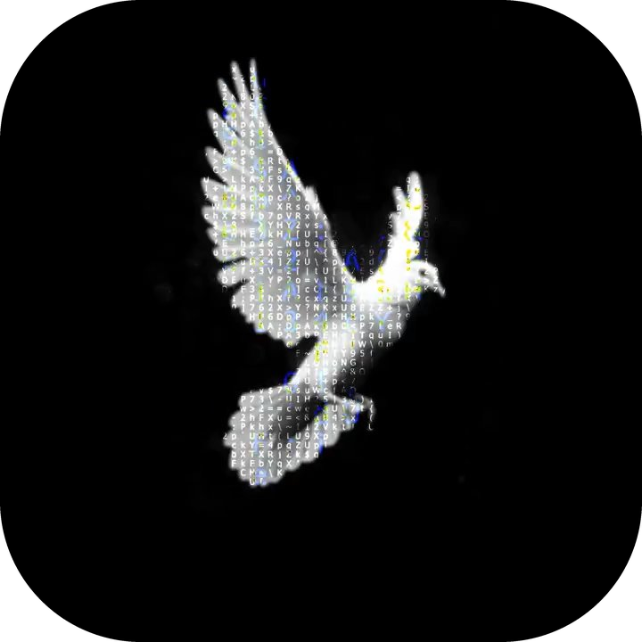

<div align="center">

<br />



# RL Swapper

**Prototype (v4.1 — Portable Rust)**

Client-side native Rust cosmetic swapper, AlphaConsole decal/ball importer, custom PFP/banner studio, map swapper, and Epic Workshop loader for Rocket League on Windows.


[](LICENSE)

[Quick Start](#quick-start) &nbsp;·&nbsp; [Features](#features) &nbsp;·&nbsp; [Building](#building-from-source) &nbsp;·&nbsp; [Structure](#project-structure) &nbsp;·&nbsp; [Notes](#notes)

</div>

---

> **Prototype Notice:** RL Swapper directly patches client-side Unreal Engine 3 `.upk` packages inside `TAGame\CookedPCConsole`. Although a 3-tier backup vault protects original files, always expect rough edges in a prototype and use **Health → Reset All Vanilla** before Rocket League updates or online troubleshooting.

---

## Features

- **Portable Native Rust Binary** — Single-file GPU UI (`eframe`/`egui`) with built-in AES-256 ECB/CTR `.upk` decryption, parallel `rayon` chunk compression, and local `CookedPCConsole` detection.
- **Automatic PC Light & Dark Theme** — Follows Windows' system appearance automatically (`Auto`) with `Dark` and `Light` overrides in the sidebar.
- **Cosmetic Slot Swapper & Paints** — Swaps `9,503` catalog items across 12 slots (`Body`, `Decal`, `Wheels`, `Rocket Boost`, `Goal Explosion`, `Trail`, `Topper`, `Antenna`, `Paint Finish`, `Engine Audio`, `Player Banner`, `Avatar Border`), with body hitbox filters and 14 official paints + custom `#RRGGBB` colors.
- **AlphaConsole Decal & Match Ball Studios** — Imports AlphaConsole `.zip`, `.json`, folder, or `.png` packs (`1_Diffuse_Skin` + `2_Diffuse_Skin_Mask` + legacy `Diffuse`/`Skin` decals; `Diffuse` + `PF_DXT1` normal-map balls) with 2D car UV and spherical ball previews and full `TextureAllocations` rebuilding.
- **Avatar PFP & Banner Studios** — Composites profile images cleanly inside all `177` `BGRA8`/`PF_DXT5` Avatar Borders with catalog-matched border names, plus `840×200` (`14:3`) Player Banner preview and injection.
- **Arena & Epic Workshop Loader** — Swaps between `96` official arenas (including Default-Size override while leaving Labs untouched), loads `.udk`/`.upk`/`.zip` Workshop maps into offline Free Play (`Labs_Underpass_P.upk`) with a `workshopTextures` dependency scanner, and browses community catalogs with a streaming download progress bar.
- **Backups, Presets & Health Guard** — Saves whole-setup presets (`%LOCALAPPDATA%\RLSwapper\presets_v4.json`), maintains `.bak` + `%LOCALAPPDATA%\RLSwapper\pristine_backups`, detects `RocketLeague.exe` binary changes, and restores single packages or full vanilla state.

---

## Quick Start

1. Download [`RL_Swapper.exe`](https://github.com/c1yq/RL-Swapper/releases/latest) (or [build from source](#building-from-source)) and run it from any folder.
2. Verify or select your Rocket League `TAGame\CookedPCConsole` folder (`Game Folder` in the sidebar).
3. Pick an item swap in **ITEMS**, customize decals/PFP/banners/balls/maps/workshop in **STUDIO**, or restore backups in **Health**.

---

## Building from Source

Requires Windows and a Rust toolchain (`1.99+`):

```bash
git clone https://github.com/c1yq/RL-Swapper.git
cd RL-Swapper
cargo build --release --bin RL_Swapper
```

The standalone executable is written to `target/release/RL_Swapper.exe`.

### Running Verification Tests

```bash
cargo check --all-targets
cargo test --release --test verify_v4_all_features -- --nocapture
```

Integration tests automatically detect local Epic/Steam Rocket League installations (or use `RL_COOKED_DIR`) and skip UPK file checks cleanly when Rocket League is not installed.

---

## Project Structure

```text
RL-Swapper/
├── Cargo.toml                  # Crate manifest & dependencies
├── assets/                     # Application icon & logo
├── src/
│   ├── lib.rs                  # Library module exports
│   ├── upk_engine.rs           # UPK header/table parser, AES-256 crypto, rewiring, paint & health vault
│   ├── icon_system.rs          # DXT1/DXT5/BGRA8 codecs, .tfc & _T_SF.upk extractors, wiki fallback
│   ├── templates.rs            # 2D Decal UV, Ball & Banner templates + studio previews
│   ├── custom_studio.rs        # AlphaConsole Decal/Ball, Avatar PFP & Banner UPK injectors
│   ├── map_editor.rs           # 96-arena catalog & default-size map swapper
│   ├── workshop.rs             # Underpass Workshop loader, dependency scanner, catalog & streaming download
│   └── bin/
│       └── swapper_gui.rs      # Main eframe/egui GUI binary (RL_Swapper)
├── tests/
│   └── verify_v4_all_features.rs
├── items.json                  # Embedded item catalog (9,503 entries)
├── keys_map.json               # Package AES key index mapping (28,639 packages)
└── keys.txt                    # Indexed AES-256 UPK keys (1,135 keys)
```

---

## Notes

- All edits are strictly local and client-side; gameplay physics, memory, and network traffic are untouched.
- Released under the [MIT License](LICENSE). Contact: **`c1ya`** on Discord.
